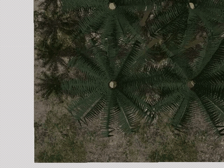
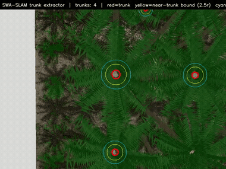
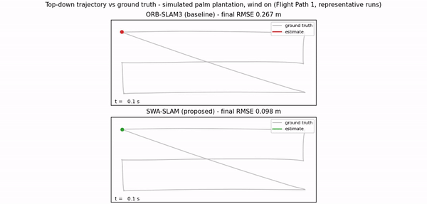

# SWA-SLAM: Stability-Weighted-Aware SLAM for Palm-Plantation UAVs

A UAV flying top-down over an oil-palm plantation is a worst case for visual
SLAM: wind keeps the canopy in constant motion, and every tree looks like every
other tree. Feature-based SLAM assumes a rigid scene, so the strongest visual
features — the waving outer fronds — are exactly the ones that corrupt the pose
estimate, and the repetitive foliage gives the tracker nothing unique to
re-anchor to once it stumbles.

**SWA-SLAM** solves this by teaching the estimator *which parts of the scene to
trust*. A lightweight color-and-morphology trunk detector finds the one thing
in a plantation that never moves — the trunks — and every visual feature is
weighted by its distance from the nearest trunk, from "rigid, trust fully"
down to "wind-blown frond, nearly ignore". When tracking degrades anyway, a
trunk-guided recovery cascade re-anchors the pose to the trunk map. No GPU, no
neural network, ~7 ms per frame.

| Flight over the plantation | Trunk detection in real time | Baseline vs SWA-SLAM |
|---|---|---|
|  |  |  |

*Full-resolution versions of all three clips are in [`media/`](media/).*

## How it works

1. **Trunk extraction** — HSV segmentation and morphology propose trunk blobs;
   a *green-ring* test (a real trunk seen from above is surrounded by an
   annulus of canopy) rejects false positives on ground and shadow.
2. **Four-tier stability weighting** — every feature is classified by its
   distance to the nearest trunk (trunk core / near-trunk / outer frond /
   non-canopy). The tier scales both the feature's detection response and its
   weight in the pose optimization, so wind-blown measurements are suppressed
   *before* they can corrupt the estimate.
3. **Trunk-guided recovery** — if tracking degrades in the repetitive canopy, a
   fallback cascade matches detected trunks against the trunk landmark map and
   re-estimates the pose from those correspondences.

## Does it work?

Evaluated in a physics-simulated plantation with animated wind: four flight
paths, **120 runs per method**, every number below significant at
p < 10⁻⁷ (Mann-Whitney U).

| | Baseline | SWA-SLAM |
|---|---|---|
| Trajectory RMSE (mean over all runs) | 0.415 m | **0.158 m  (−62 %)** |
| Distance flown blind after tracking loss | 26.3 m | **11.8 m  (−55 %)** |
| Frames with a pose | 82.8 % | **92.7 %** |
| Worst single run | 3.79 m | **0.51 m** |

For context, DynaSLAM — a deep-learning dynamic-SLAM system — reaches a
comparable RMSE on these sequences but only ever tracks 56 % of the frames:
its COCO-trained segmentation has no notion of vegetation, so it cannot see
the fronds coming. The trunk prior is what keeps SWA-SLAM alive.

## Demo videos

| File | What it shows |
|---|---|
| [`media/01_camera_feed.mp4`](media/01_camera_feed.mp4) | The raw onboard view: wind-blown, repetitive canopy at 60 fps |
| [`media/02_trunk_detection.mp4`](media/02_trunk_detection.mp4) | The trunk extractor live: detected trunks (red), stability boundary (yellow), canopy-ring check (cyan) |
| [`media/03_trajectory_comparison.mp4`](media/03_trajectory_comparison.mp4) | Side-by-side trajectory against ground truth, baseline vs SWA-SLAM |
| [`media/04_baseline_live_view.mp4`](media/04_baseline_live_view.mp4) | The baseline system running live (4x speed): feature tracking on the left, map and estimated trajectory on the right |
| [`media/05_swaslam_live_view.mp4`](media/05_swaslam_live_view.mp4) | SWA-SLAM on the same flight (4x speed): stable tracking through the canopy and a continuous trajectory |

## Status and availability

A paper describing the method and evaluation in full is in preparation for
journal submission. SWA-SLAM is built as an extension of the open-source
ORB-SLAM3 framework (Campos et al., IEEE T-RO 2021); the trunk detector,
stability-tier weighting, and trunk-guided recovery presented here are
original contributions of this work. The implementation is not publicly
released; access may be requested from the author.

## Author

**Khay Yi Teo** — PhD candidate, Department of Electrical and Robotics
Engineering, Monash University Malaysia, in collaboration with DroneDash
Technologies Pte Ltd.
